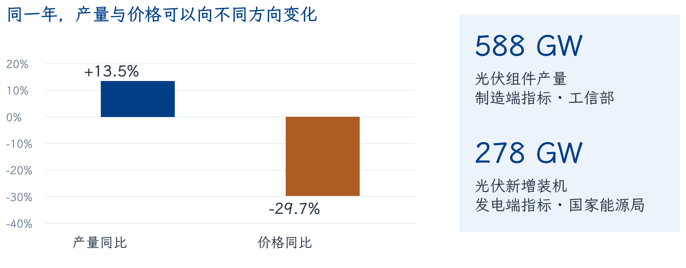
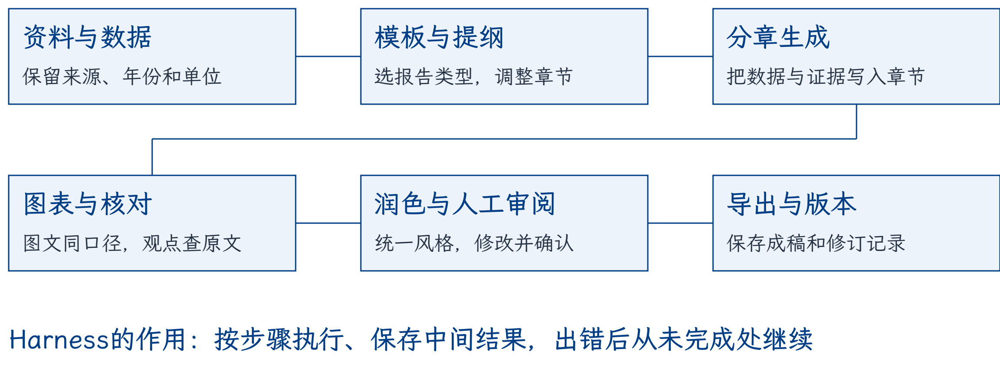
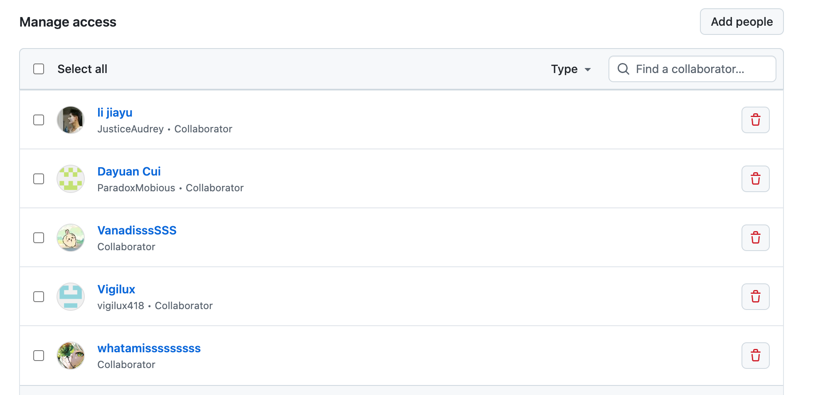
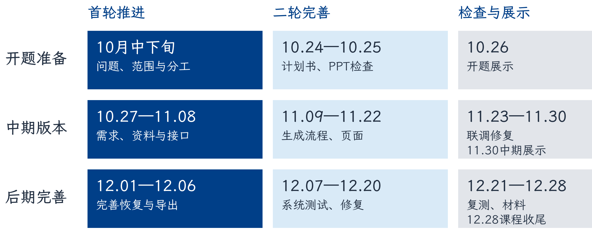

# 产业智能报告生成系统
## 项目计划书

《软件工程管理》第十一组小组开题

**版本**：v1.6　**日期**：2026-10-26　**开题展示**：2026-10-26

**组长**：程文博

**组员**：田亦洁、李佳雨、许子萌、崔大元、郭润航

**展示人**：郭润航

### 项目目标

先生成可核对的草稿，再由人修改和确认，形成完善的产业报告。

## 目录

| 章节 | 内容 | 页码 |
| --- | --- | --- |
| 1 | 课题背景、范围与创新安排 | 2 |
| 2 | 可核对的产业简报场景 | 3 |
| 3 | 交付物、状态与验收 | 4 |
| 4 | 技术方案与Harness | 5 |
| 5 | 六人分工与GitHub协作 | 6 |
| 6 | 三级WBS与工作量估算 | 7 |
| 7 | 时间安排与里程碑 | 8 |
| 8 | 资源投入、成本记录与风险 | 9 |
| 9 | 质量、AI使用与来源 | 10 |

<!-- pagebreak -->

# 1 课题背景与课程依据

本项目对应P4第7页的课题2：面向政府智库、产业规划、行业研究，构建模板化、结构化、可溯源、可定制的报告生成引擎。目标是提升文稿效率、统一结构，并加强数据与内容联动；首轮用公开资料验证。资料分散、结构反复搭建和观点难回查是课题与流程分析提出的问题假设，尚无真实用户访谈或收益测量。

### 1.1 从课堂方法形成项目安排

| 课程依据 | 方法要点 | 本项目采用方式 |
| --- | --- | --- |
| P4第24、32、43页 | 滚动计划、责任矩阵、三级WBS | 项目—工作包—可验收子任务；执行、评审、确认分别落实 |
| P5第6、12页 | 以报告系统讲功能划分；三点估算 | 按资料、模板、生成、审阅、导出拆解；对Harness作情景估算 |
| P5第17—21、28页 | 依赖、甘特图、关键路径、里程碑 | 用进度图找串行链与可并行工作，按产物检查完成情况 |

根据组长说明，上节课学长分享了Harness。本组由此关注长任务的步骤、状态和接续；技术细节另核对Anthropic与LangGraph官方资料[R1—R3]。课堂分享的定位见课程映射，不把公开文档的表述归为学长原话。

### 1.2 目标与范围

模板体系面向产业分析、景气、对标、招商、出海研判五类报告。核心包括模板管理、提纲及分章生成、数据嵌入与自动图表、观点溯源、公文风格润色、多格式导出和版本管理。本期先以产业分析、对标两类及两个产业验收完整流程，其余三类逐步扩展；底层训练、无人审核发布不纳入本期。

资料、模板与业务流程分离；产业案例是验证输入，不把系统限定为某一产业。两种模板及代表资料由组长组织细化确认，具体章节和样例待需求核实。

### 1.3 在实践中形成创新

我们会在不断摸索和验证的过程中，逐步形成自己的创新。先从资料核对、任务接续和人工审阅中的实际问题入手，小范围试验，把有效改进留下来；不把设想或AI建议直接当作创新成果。

<!-- pagebreak -->

# 2 一个可核对的产业简报场景

用户整理“2024年光伏产业简报”，选取制造运行、能源装机等来源，要求报告区分指标对象、年份和单位，关键表述可回到原文。

工信部披露，2024年光伏组件产量588GW，同比增长13.5%，组件价格同比下降29.7%[D1]。国家能源局披露，同年光伏新增装机2.78亿千瓦，换算为278GW[D2]。制造产量与新增装机不能混写，也不能仅凭产量增长判断利润增长。

### 2.1 预期输出与检查

正确的事实句应保留“2024年、组件产量、588GW、来源D1”；若草稿写成“新增装机588GW”，审阅者应回查指标并纠正。图表数据同样保存来源、时间及单位。此处是人工编写的设计例子，不是模型效果评测。

第二个候选产业为新能源汽车：工信部发布的2024年全年产量1288.8万辆、销量1286.6万辆[D3]，可检验产销口径是否分离。使用2024完整年度数据便于同口径举例，不称其为当前最新数据。完整验证时每个产业补足至少3份允许使用的公开资料。

### 2.2 用户操作

导入资料并选模板，生成提纲及章节，定位原文、人工修订后确认导出。现有原型可实际完成文本录入、摘录、来源快照和Markdown下载；本次原型截图使用上述公开事实的人工整理，没有调用模型。真实用户任务、模型生成和跨产业效果仍需后续执行并留证。

<!-- pagebreak -->

# 3 交付物、状态与验收

| 交付物 | 当前基础与计划能力 | 学期验收条件 |
| --- | --- | --- |
| D1 资料管理 | 已有文本、元数据与SQLite；补充解析及资料版本 | 标题、机构、日期、链接与正文可查；重启可读；非法输入不写入 |
| D2 模板生成 | 已有摘录和单次模型适配；增加可配置模板、提纲与章节 | 产业分析、对标两类模板可选；两个产业各至少3份资料，复用同一主模板，不改流程代码 |
| D3 引用审阅 | 已有标记与原文快照；增加检查、修订及确认状态 | 每份抽查至少5条关键表述；回查数字、单位、时段及支持关系；保留原稿与修订稿 |
| D4 执行恢复 | 当前同步请求；增加步骤状态、检查点与调用记录 | 注入章节失败后成功产物保留；恢复只处理未完成步骤；结果不明的调用转人工 |
| D5 图表导出 | 已有Markdown；增加数据入文、自动图表、公文风格润色及PDF或DOCX | 至少1种自动图表，标来源与单位；润色不改事实；Markdown及PDF或DOCX可读 |
| D6 运行证据 | 已有代码、说明及18项基线测试；完善系统测试 | 新环境可启动；需求、设计、实现与测试对应；演示和材料使用一致版本 |

### 3.1 非功能与数据边界

本地服务绑定127.0.0.1。密钥、运行数据库和受限原文不提交；模型外发前核对资料许可。输入总量与上下文预算按样例测量，不能把字符上限当作token预算。模型超时、格式错误和截断明确失败，不静默切换成摘录或宣称成功。

引用标签仅能定位资料，不能自动证明内容正确。对无法支持的观点标记资料不足；不提供未经验证的产业预测或投资判断。性能记录环境、资料规模、耗时及调用量，不预填没有测量依据的准确率或速度。

### 3.2 变更确认

T0组织确认用户任务、模板、资料和验收条件。范围、资源或里程碑变化记录原因、影响、负责人、决定及版本，并同步设计、实现、测试、报告与PPT。上述表格为学期目标，不能视为全部已实现。

<!-- pagebreak -->

# 4 技术方案与Harness

### 4.1 当前实现

浏览器提交JSON，Server检查路由与请求，Service校验主题及资料ID，Store使用SQLite保存资料和报告。Generator执行确定性摘录或一次兼容模型请求，成功后保存Markdown、警示和原文快照。列表只返回元数据，完整原文按ID读取。

### 4.2 从单次调用到可恢复流程

本期先采用明确的工作流，模型承担提纲及章节内容生成，程序负责状态、产物和约束，人工负责事实与发布。这与[R2]区分固定工作流和自主Agent的思路一致；暂不引入复杂多Agent调度。

借鉴[R1]分段推进、保留进度与产物的思路，按任务记录输入版本、模板版本、步骤、输出、错误和用量。参考[R3]的检查点持久化原则，进程重启后应读取持久化状态；仅保存在内存不能作为重启恢复。是否采用LangGraph待小样例验证，当前不预设框架。

### 4.3 失败与依赖

章节失败时保留成功产物，从未完成步骤继续；输入或模板变化则使相关旧产物失效。只有明确可安全重试的失败才有限重试；超时不等于供应商未执行，结果不明时先人工确认，避免盲目重复付费。调用结果不明时不盲目重复请求。

业务基线使用Python标准库、SQLite与原生Web。解析、图表和导出库先验证中文、表格和分页；材料构建依赖与业务运行依赖分开。恢复、真实模型和产业效果尚未实现验证。

<!-- pagebreak -->

# 5 六人分工与协作

| 成员（计划人时） | 学期主责 | 交付与复核 |
| --- | --- | --- |
| 程文博（40） | 统筹、架构评审与验收 | 版本、资源与验收；全组复核 |
| 田亦洁（44） | 需求与系统设计 | 需求、接口、验收；许子萌复核 |
| 李佳雨（44） | 前端、审阅与导出 | 页面、图表、导出；田亦洁复核 |
| 郭润航（40） | 测试、部署与演示 | 测试与演示；各作者处理缺陷并复测 |
| 崔大元（44） | 资料与数据处理 | 资料、许可、版本；田亦洁核对 |
| 许子萌（56） | Harness与生成后端 | 模板、分章、恢复；李佳雨及郭润航核对 |

各模块由负责人牵头，其他成员交叉核对，组长确认范围与最终提交。交接说明版本、输入输出、失败边界和未完成项，每人须能解释自己的实现。

### 5.1 共用仓库、分支修改与PR检查

统一仓库：[BrockPhlin/industry-report-harness](https://github.com/BrockPhlin/industry-report-harness)。五个协作者账号加仓库所有者，共同维护项目。

{width=70%}

按分工记录任务和完成条件，在各自分支修改；PR说明变化、检查及遗留项，由其他成员复核后交组长确认合并，成员拉取更新。代码、报告和PPT源码同步维护，PPTX由李佳雨整合，避免多人覆盖。

权限名单只说明协作入口，实际成果以任务、PR和验证记录核对。已有[代码PR #5](https://github.com/BrockPhlin/industry-report-harness/pull/5)和[课程资料PR #6](https://github.com/BrockPhlin/industry-report-harness/pull/6)可查。

<!-- pagebreak -->

# 6 三级WBS与工作量估算

按P4第43页，采用“P0项目—W0至W6工作包—Wn.1至Wn.3子任务”三层结构；表中三个子任务均有源码、记录或可运行样例作为完成依据。

| 工作包与牵头人 | 三级子任务（各包编号.1/.2/.3） | 计划人时 |
| --- | --- | --- |
| W0 程文博 | 范围计划 / 评审变更 / 冻结提交 | 16 |
| W1 崔大元 | 用户任务 / 来源许可 / 课程映射 | 28 |
| W2 田亦洁 | 需求验收 / 接口数据 / 基线评审 | 32 |
| W3 崔大元 | 导入解析 / 元数据版本 / 样例检查 | 40 |
| W4 许子萌 | 模板步骤 / 章节引用 / 恢复记录 | 56 |
| W5 李佳雨 | 前端进度 / 审阅版本 / 图表导出 | 44 |
| W6 郭润航 | 跨产业联调 / 故障复测 / 部署演示 | 52 |

合计268人时。21个子任务的负责人、协作者与分摊在team/wbs.csv，父工作包在semester-plan.csv；逐包及逐人合计一致。W4由许子萌40、程文博16人时协作，后者用于接口协调、资源和验收，不把全部开发任务集中给一人。

### 6.1 三点估算示例

按P5第12页，为W4设乐观O=40、最可能M=52、悲观P=88人时，期望E=(40+4×52+88)/6=56人时，标准差为8人时。取值分别代表复用顺利、正常集成、引用或外部调用返工三种情景，是初估假设，不是历史测量或成员承诺。

P5第6页用本课题说明采集接口、模板输入、预览导出、查询与存储的功能划分。本组据此检查WBS是否漏项；未进行标准功能点权重计算，不把上述分类称为已完成的功能点评估。

268人时沿用当前点估计；按周记录实际投入与返工，需求细化后滚动更新。AI可辅助列任务和计算，人负责范围、估计依据与承诺。

<!-- pagebreak -->

# 7 依赖、进度与里程碑

按课程课表和P5的排期方法，分开题、中期和后期三阶段推进。各阶段先开发、再完善，最后检查；内部日期为组内暂排。

核心开发另按依赖细排：A→B→C→D→E，工期5+3+6+4+5=23日；前端F历时3日，有6日总浮动。3日缓冲放在核心联调之后。计算见team/core-schedule.json及tools/plan_math.py；试排不等同于所有268人时的资源排程，待个人每周可用时间与正式日期确认后重排。

| 阶段 | 里程碑与责任 | 通过条件 |
| --- | --- | --- |
| 10月25日内部冻结；26日开题 | T0组织一致性检查，郭润航展示 | 计划书、PPT、源码与现状一致；实际彩排留记录 |
| 开题后第1—2周 | M1；田亦洁、崔大元交需求资料，T0评审 | 任务、许可、模板与验收基线可查 |
| 11月30日中期（课表） | M2；W3—W5集成，郭润航牵头联调 | 两产业复用主模板；至少1周联调修复 |
| 12月完善、测试与收尾 | M3/M4；完善恢复导出，郭润航牵头测试 | 终期前3周集中系统测试；缺陷复测和材料一致 |

课程介绍《课时安排》列11月30日中期、12月28日课程收尾；正式提交与终期答辩以最新通知为准，公布后两日内更新。每周检查依赖和产物，关键路径延误优先处理。

<!-- pagebreak -->

# 8 资源投入、成本记录与主要风险

### 8.1 成本与投入安排

| 资源项 | 当前安排 | 依据与记录方式 |
| --- | --- | --- |
| 人员投入 | 按任务汇总268计划人时 | 见WBS分摊；每周记录实际投入和返工，不直接当贡献分 |
| 设备与部署 | 使用现有电脑，本地开发和演示 | 不安排新增采购；确需外网资源时先说明用途再确认 |
| 模型与外部服务 | 服务及付费方案尚未确定 | 先用小样例验证，确定方案后按实际调用和账单记录费用 |
| 资料与存储 | 公开资料、项目仓库及本地存储 | 核对资料许可，不上传密钥、运行库和受限原文 |

目前没有可核对的现金估计依据，不预设金额，也不把现有设备写成已新增支出。确有新增费用时，负责人说明用途、计费依据和用量，经组长确认后使用。

### 8.2 主要风险与处理

| 风险与触发条件 | 影响 | 措施与责任 |
| --- | --- | --- |
| 用户任务或模板反复变化 | 范围和验收不稳定 | 田亦洁维护需求，程文博记录影响并确认变更 |
| 资料许可不清、指标口径混淆 | 资料不能使用或内容失实 | 崔大元核对来源，内容作者回查时间、单位与对象 |
| 模型失败、调用结果不明 | 生成中断、重复请求 | 许子萌记录步骤与异常；先核对结果，再决定是否重试 |
| 关键任务卡住、成员负荷过高 | 接口交接与联调受阻 | 程文博协调补位，先打通主要流程，扩展功能后移 |
| 代码和材料版本不一致 | 演示结果与讲述不符 | 作者同步源码和材料，郭润航复测、彩排，组长冻结版本 |

<!-- pagebreak -->

# 9 质量、AI使用与来源

2026-10-26使用Python 3.12.14复核基线1d7e104，18项测试通过，覆盖持久化、输入校验、来源快照及本地HTTP流程。模型使用模拟响应，不证明产业质量；后续开展联调、真实资料流程、故障恢复与人工抽查。

按P5第28页检查里程碑，D1—D6对应需求、设计、实现与测试。尚无同一口径的实际投入和验收完成量，不填造SPI/CPI。至少记录启动、阶段检查、交付准备三轮真实会议。

| 工作 | AI用途 | 人工核验 |
| --- | --- | --- |
| 文档与PPT | 起草、结构、排版与算术辅助 | 田亦洁/李佳雨核对内容，崔大元核对课程来源，T0组织确认 |
| 编码与测试 | 样板和重复代码、测试初稿 | 各作者解释实现；郭润航牵头测试，人工确认预期并实际执行 |
| 产业内容 | 组织章节与改写 | 资料及内容负责人检查证据；事实、数字与最终发布由人判断 |

### 9.1 可定位来源

| 编号 | 来源与定位 | 使用内容 |
| --- | --- | --- |
| C1/C2 | P4第7、24、32、43页；P5第6、12、17—21、28—30页 | 课题、WBS、估算、责任与进度 |
| R1 | [Anthropic长期任务Harness原文](https://www.anthropic.com/research/effective-harnesses-for-long-running-agents) | 分段推进与留下可接续产物 |
| R2/R3 | [Anthropic工作流原文](https://www.anthropic.com/research/building-effective-agents)；[LangGraph持久化文档](https://docs.langchain.com/oss/python/langgraph/persistence) | 明确步骤、检查点与恢复边界 |
| D1/D2 | [工信部2024光伏制造](https://www.miit.gov.cn/gyhxxhb/jgsj/dzxxs/dzjc/art/2025/art_da51f7f47c75477ea1fa6732155536db.html)；[国家能源局2024并网运行](https://obor.nea.gov.cn/detail2/21770.html) | 产量、价格、装机口径 |
| D3 | [工信部2024汽车工业运行](https://www.miit.gov.cn/jgsj/zbys/gzdt/art/2025/art_e4f577dfac694724a108cbdca9a612d3.html) | 第二产业候选资料 |

课程页码见materials/课程内容映射.csv；指纹与外部来源见materials/references的teacher-files.json和research-notes.md。课件及课堂记录的存放位置见materials/course-slides/README.md。

本次交计划书PDF、PPTX及展示PDF并保留源码，提交以通知为准。v1.6回归选题四项核心内容，明确五类报告与首轮两类验收；工作目录仅留当前稿，旧稿由Git历史保留。
