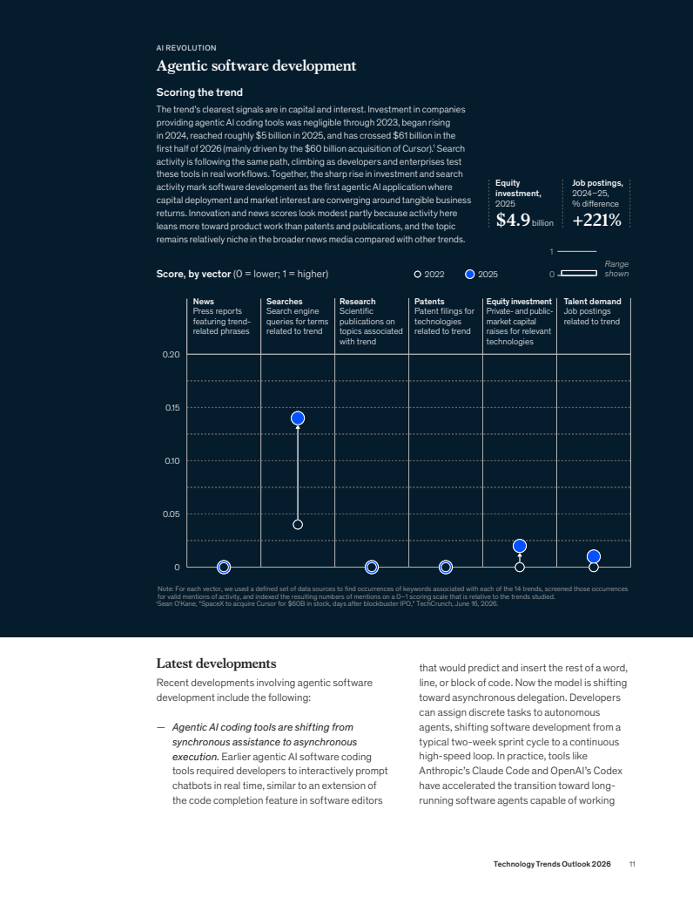
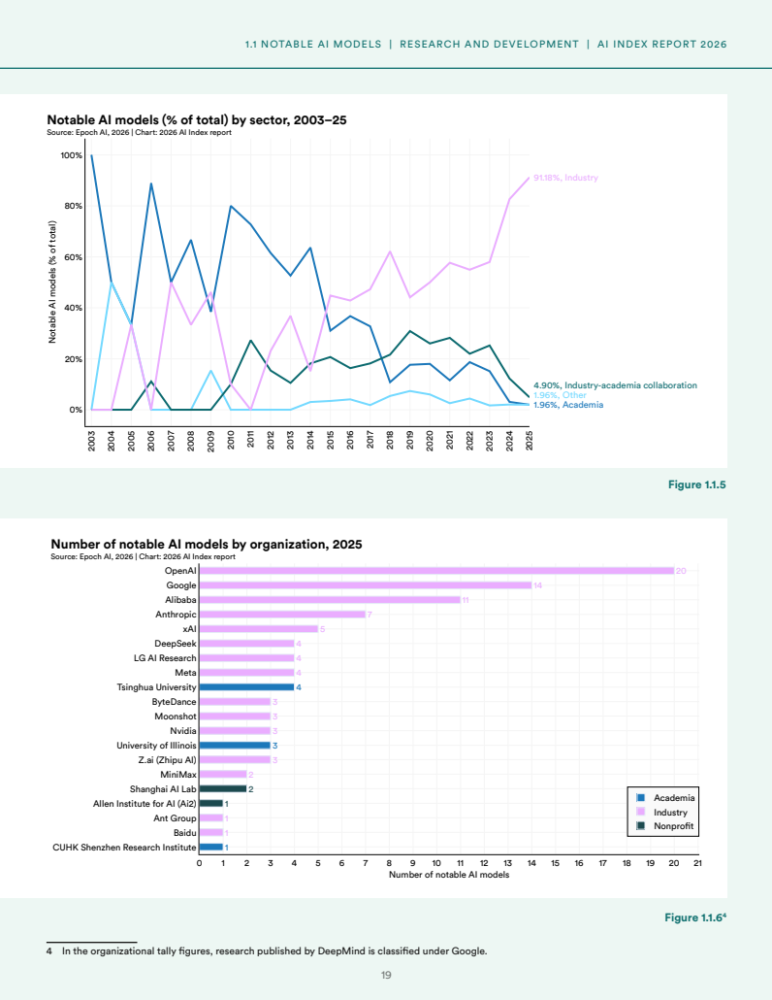

# 产业智能报告生成系统
## 项目计划书

《软件工程管理》第十一组小组开题

**版本**：v1.8.2　**日期**：2026-10-26　**开题展示**：2026-10-26

**组长**：程文博

**组员**：田亦洁、李佳雨、许子萌、崔大元、郭润航

**展示人**：郭润航

### 项目目标

先生成可核对的草稿，再由人修改和确认，形成完善的产业报告。

<!-- pagebreak -->

## 目录

| 章节 | 内容 | 正文页码 |
| --- | --- | --- |
| 1 | 课题背景、范围与创新安排 | 1 |
| 2 | 可核对的产业简报场景 | 2 |
| 2.3 | 两份参考报告分析与成品目标 | 3 |
| 3 | 交付物、状态与验收 | 4 |
| 4 | 技术方案与Harness框架参考 | 5 |
| 5 | 六人分工与GitHub协作 | 6 |
| 6 | 任务分解与小样例验证 | 7 |
| 7 | 时间安排与里程碑 | 8 |
| 8 | 资源投入、成本记录与风险 | 9 |
| 9 | 质量、AI使用与来源 | 10 |

封面、目录不编正文页码；正文从第1页开始，共10页。目录页码可点击跳转。

<!-- pagebreak -->

# 1 课题背景与课程依据

本项目对应P4第7页的课题2：面向政府智库、产业规划、行业研究，构建模板化、结构化、可溯源、可定制的报告生成引擎。目标是提高效率、规范结构和联动数据；首轮用公开资料验证。问题来自选题定义，真实需求与收益待验证。

### 1.1 从课堂方法形成项目安排

| 课程依据 | 方法要点 | 本项目采用方式 |
| --- | --- | --- |
| P4第24、32、43页 | 滚动计划、责任矩阵、三级WBS | 项目—工作包—可验收子任务；执行、评审、确认分别落实 |
| P5第6页 | 以报告系统讲功能划分 | 按资料、模板、生成、审阅、导出划分任务并检查覆盖 |
| P5第17—21、28页 | 依赖、甘特图、关键路径、里程碑 | 用进度图找串行链与可并行工作，按产物检查完成情况 |

结合上节课学长的Harness分享，关注步骤、状态与接续；技术细节核对[R1—R3]，分享定位见课程映射，不把官方文档冒充课堂原话。

### 1.2 目标与范围

模板体系面向产业分析、景气、对标、招商、出海研判五类报告。核心包括模板管理、提纲及分章生成、数据嵌入与自动图表、观点溯源、公文风格润色、Markdown与多版式PDF导出和版本管理。本期先以产业分析、对标两类及两个产业验收完整流程，其余三类逐步扩展；底层训练、无人审核发布不纳入本期。

资料、模板与业务流程分离；产业案例是验证输入，不把系统限定为某一产业。内容模板规定章节，版式模板规定PDF排版；章节及样例待需求核实。

### 1.3 在实践中形成创新

我们会在不断摸索和验证的过程中，逐步形成自己的创新。首个试验是参考报告检索：写前查结构与写法，事实仍用本次资料；对照有无工具的结构完整性、事实错误和人工修改量，结果待实际验证。

<!-- pagebreak -->

# 2 一个可核对的产业简报场景

用户整理“2024年光伏产业简报”，选取制造运行、能源装机等来源，要求报告区分指标对象、年份和单位，关键表述可回到原文。

工信部披露，2024年光伏组件产量588GW，同比增长13.5%，组件价格同比下降29.7%[D1]。国家能源局披露，同年光伏新增装机2.78亿千瓦，换算为278GW[D2]。制造产量与新增装机不能混写，也不能仅凭产量增长判断利润增长。

### 2.1 预期输出与检查

事实句及图表保留年份、对象、数值、单位和来源；“新增装机588GW”应回查并纠正。此处为人工设计例子，不是模型评测。

第二个候选产业为新能源汽车，使用工信部2024年产销资料[D3]检查口径。两个产业各补足至少3份许可清楚的公开资料；历史数据不称为当前最新数据。

### 2.2 用户操作

流程为资料导入、模板生成、原文核对、人工修订和导出。当前原型仅有录入、摘录、来源快照与Markdown下载；截图未调用模型，真实用户与跨产业效果待验证。

<!-- pagebreak -->

# 2.3 两份参考报告分析与成品目标

两份外部报告是“内容怎样组织、PDF怎样呈现”的参考，不是本组生成的成果。下图为PPT中展示的相同原始页面，原PDF及印刷页码均保留，便于核对。

| McKinsey参考页 | Stanford参考页 |
| --- | --- |
|  |  |

### McKinsey《Technology Trends Outlook 2026》[R4]

报告目录按技术主题组织，研究方法单独说明；示例页把指标、趋势解读和后续发展放在一起。我们借鉴“同类章节采用统一结构、指标与解释对应”的方式，设计内容模板，避免每章的组织方式随意变化。观察位置：PDF第3、5、13页，对应印刷第1、3、11页。

### Stanford《AI Index Report 2026》[R5]

总目录与章内目录体现层级；示例页为图表标注标题、编号、数据来源和备注。我们借鉴这种图表与证据组织方式，让读者能区分指标口径并回到资料核对。观察位置：PDF第2、14、20页，对应印刷第1、13、19页。

### 落到本系统的目标

正文、表格、图表引用和来源标记保存为Markdown；内容模板规定章节，版式模板控制字体、目录、页眉页脚及分页。同一确认稿分别导出研究版与简报版PDF，事实和引用保持一致。

参考报告检索工具按当前章节返回相关结构、少量写法片段与图表规范，附报告名称、页码及片段ID；只借鉴表达，当前事实另由本次资料支撑。两份报告不能覆盖所有报告类型，不匹配时应提示，不编造参考结果；效果仍需有无工具的对照验证。

不照搬机构标识或分析结论，不承诺同样篇幅、数据规模和研究能力。原文件由组长提供，文件指纹与预览位置见materials/references/output-report-targets.json。

<!-- pagebreak -->

# 3 交付物、状态与验收

| 交付物 | 当前基础与计划能力 | 学期验收条件 |
| --- | --- | --- |
| D1 资料管理 | 已有文本、元数据与SQLite；补充解析及资料版本 | 标题、机构、日期、链接与正文可查；重启可读；非法输入不写入 |
| D2 模板生成 | 已有摘录和单次模型适配；增加可配置模板、参考检索、提纲与章节 | 产业分析、对标两类模板可选；两个产业各至少3份资料，复用同一主模板，不改流程代码 |
| D3 引用审阅 | 已有标记与原文快照；增加检查、修订及确认状态 | 每份抽查至少5条关键表述；回查数字、单位、时段及支持关系；保留原稿与修订稿 |
| D4 执行恢复 | 当前同步请求；增加步骤状态、检查点与调用记录 | 注入章节失败后成功产物保留；恢复只处理未完成步骤；结果不明的调用转人工 |
| D5 图表导出 | 已有Markdown；增加数据入文、自动图表、润色及双版式PDF | 同一Markdown导出研究版、简报版两种PDF；图表带来源单位，事实一致，中文分页可读 |
| D6 运行证据 | 已有代码、说明及18项基线测试；完善系统测试 | 新环境可启动；需求、设计、实现与测试对应；演示和材料使用一致版本 |

### 3.1 非功能与数据边界

本地服务绑定127.0.0.1。密钥、运行数据库和受限原文不提交；模型外发前核对资料许可。输入与上下文限制先以样例验证。模型异常明确报错，不以摘录冒充生成成功。

引用标签仅能定位资料，不能自动证明内容正确。对无法支持的观点标记资料不足；不提供未经验证的产业预测或投资判断。性能记录环境、资料规模、耗时及调用量，不预填没有测量依据的准确率或速度。

### 3.2 变更确认

T0组织确认用户任务、模板、资料和验收条件。范围、资源或里程碑变化记录原因、影响、负责人、决定及版本，并同步设计、实现、测试、报告与PPT。上述表格为学期目标，不能视为全部已实现。

<!-- pagebreak -->

# 4 技术方案与Harness框架参考

### 4.1 当前实现

浏览器提交JSON，Server检查路由与请求，Service校验主题及资料ID，Store使用SQLite保存资料和报告。Generator执行确定性摘录或一次兼容模型请求，成功后保存Markdown、警示和原文快照。列表只返回元数据，完整原文按ID读取。

### 4.2 从单次调用到可恢复流程

{width=75%}

按[R2]分章生成Markdown，资料和图表数据另存。人工确认后选版式导出PDF，记录内容、资料、模板及产物版本；换版式不重新生成结论，Harness管理执行状态。

参考检索按类型和章节返回结构、写法及图表规范，附来源、页码与片段ID；限制长度，无匹配则提示，参考结论不作为当前事实。

按[R1—R3]保留产物、错误、用量与持久化检查点，重启后从存储恢复，不能仅依靠内存。

### 4.3 失败与依赖

章节失败时保留成功产物，从未完成步骤继续；输入或模板变化则使相关旧产物失效。只有明确可安全重试的失败才有限重试；超时不等于供应商未执行，结果不明时先人工确认，避免盲目重复付费。

业务基线为Python、SQLite与原生Web；渲染需验证中文和分页，生成文本不直接执行。材料构建与业务依赖分开，真实模型、完整恢复与产业效果仍待验证。

### 4.4 可参考的框架与取舍

**DeepSeek Harness（dsh）[R6]**：官方项目基于Cordis，采用插件化架构。可借鉴工具扩展与执行轨迹；其Node.js运行及插件接入与当前Python后端如何衔接、能否适配GLM API，均需实测。开发者预览存在兼容性变更，不直接当作本组已采用的底座。

**LangGraph [R3]**：借鉴图状态、持久化检查点和人工介入。Python方向便于作为对照候选；内存检查点不保证重启恢复，应验证持久化存储。

**Deep Agents [R7]**：基于LangGraph提供文件系统、上下文管理和自定义工具等能力。可参考工具与资料组织；本期不因框架具备某功能就扩展范围，先与简单固定工作流对照。

<!-- pagebreak -->

# 5 六人分工与协作

| 成员 | 学期主责 | 交付与复核 |
| --- | --- | --- |
| 程文博 | 统筹、架构评审与验收 | 版本、资源与验收；全组复核 |
| 田亦洁 | 需求与系统设计 | 需求、接口、验收；许子萌复核 |
| 李佳雨 | 前端、审阅与导出 | 页面、图表、导出；田亦洁复核 |
| 郭润航 | 测试、部署与演示 | 测试与演示；各作者处理缺陷并复测 |
| 崔大元 | 资料与数据处理 | 资料、许可、版本；田亦洁核对 |
| 许子萌 | Harness与生成后端 | 模板、分章、恢复；李佳雨及郭润航核对 |

各模块由负责人牵头，其他成员交叉核对，组长确认范围与最终提交。交接说明版本、输入输出、失败边界和未完成项，每人须能解释自己的实现。

### 5.1 共用仓库、分支修改与PR检查

统一仓库：[BrockPhlin/industry-report-harness](https://github.com/BrockPhlin/industry-report-harness)。五个协作者账号加仓库所有者，共同维护项目。

{width=70%}

按分工记录任务和完成条件，在各自分支修改；PR说明变化、检查及遗留项，由其他成员复核后交组长确认合并，成员拉取更新。代码、报告和PPT源码同步维护，PPTX由李佳雨整合，避免多人覆盖。

每周一下午软工管课后简单讨论进展、问题与下周任务，记录变更。权限不等于贡献。已有[代码PR #5](https://github.com/BrockPhlin/industry-report-harness/pull/5)和[课程资料PR #6](https://github.com/BrockPhlin/industry-report-harness/pull/6)可查。

<!-- pagebreak -->

# 6 任务分解与小样例验证

依P4第43页，将项目分为工作包及可验收子任务；保留负责人、依赖和产出，不列工时估计。完成情况看实际交付、评审及验证记录。

| 工作包与牵头人 | 子任务 | 完成依据 |
| --- | --- | --- |
| W0 程文博 | 范围计划、评审变更、冻结提交 | 范围、决定和版本可核对 |
| W1 崔大元 | 用户任务、来源许可、课程映射 | 任务与资料来源清楚 |
| W2 田亦洁 | 需求验收、接口数据、基线评审 | 开发与测试使用同一规则 |
| W3 崔大元 | 导入解析、元数据版本、样例检查 | 两产业输入可复用、可回查 |
| W4 许子萌 | 模板检索、分章引用、执行恢复 | 步骤产物和异常可定位 |
| W5 李佳雨 | 页面进度、审阅版本、图表导出 | 用户能核对、修改及导出 |
| W6 郭润航 | 跨产业联调、故障复测、部署演示 | 测试结果、缺陷及运行说明齐全 |

### 6.1 框架选择先做最小验证

不预设“框架越重效果越好”，以同一条报告流程比较简单工作流与候选方案。模型调用使用组长提供的GLM-5.3-Flash资源，重点看Harness可用性，尚无框架兼容或效果结论。

| 检查环节 | 通过条件 |
| --- | --- |
| 模型与工具 | 接口和工具参数可解析；错误明确返回，不假装成功 |
| 参考检索 | 返回相关片段及页码；无匹配不编造；保留调用记录 |
| 保存与接续 | 注入章节失败后保留成功产物，重启可定位未完成步骤 |
| 内容与导出 | 修订留版本；同一Markdown的两版PDF事实和来源一致 |

### 6.2 参考工具的对照验证

固定资料、任务、内容模板、模型与生成参数，对照关闭和开放参考工具，记录是否实际调用。人工按预设规则比较章节完整性、事实错误、修改量及额外调用开销；结果以实际运行记录为准，不预填提升比例。每周一课后据此决定修复、保留或暂缓某项能力。

<!-- pagebreak -->

# 7 依赖、进度与里程碑

按课程课表和P5的排期方法，分开题、中期和后期三阶段推进。各阶段先开发、再完善，最后检查；内部日期为组内暂排。

核心开发另按依赖细排：A→B→C→D→E，工期5+3+6+4+5=23日；前端F历时3日，有6日总浮动。3日缓冲放在核心联调之后。计算见team/core-schedule.json及tools/plan_math.py；试排不等同于全项目资源平衡，待个人每周可用时间与正式日期确认后重排。

| 阶段 | 里程碑与责任 | 通过条件 |
| --- | --- | --- |
| 10月25日内部冻结；26日开题 | T0组织一致性检查，郭润航展示 | 计划书、PPT、源码与现状一致；实际彩排留记录 |
| 开题后第1—2周 | M1；田亦洁、崔大元交需求资料，T0评审 | 任务、许可、模板与验收基线可查 |
| 11月30日中期（课表） | M2；W3—W5集成，郭润航牵头联调 | 两产业复用主模板；至少1周联调修复 |
| 12月完善、测试与收尾 | M3/M4；完善恢复导出，郭润航牵头测试 | 终期前3周集中系统测试；缺陷复测和材料一致 |

课程介绍《课时安排》列11月30日中期、12月28日课程收尾；正式提交与终期答辩以最新通知为准，公布后两日内更新。周一课后检查依赖和产物，关键路径延误优先处理。

<!-- pagebreak -->

# 8 资源投入、成本记录与主要风险

### 8.1 成本与投入安排

| 资源项 | 当前安排 | 依据与记录方式 |
| --- | --- | --- |
| 人员协作 | 按六人主责与任务安排推进 | 记录实际交付、投入与返工，不预设工时或贡献分 |
| 设备与部署 | 使用现有电脑，本地开发和演示 | 不安排新增采购；确需外网资源时先说明用途再确认 |
| 模型API | 组长程文博个人提供GLM-5.3-Flash API | 主要验证Harness可用性，记录调用量及实际费用 |
| 资料与存储 | 公开资料、项目仓库及本地存储 | 核对资料许可，不上传密钥、运行库和受限原文 |

主要用于Harness的小样例测试，沿用组长已有API资源，不另设固定采购预算；调用量和费用按实际记录。

### 8.2 主要风险与处理

| 风险与触发条件 | 影响 | 措施与责任 |
| --- | --- | --- |
| 用户任务或模板反复变化 | 范围和验收不稳定 | 田亦洁维护需求，程文博记录影响并确认变更 |
| 资料许可不清、指标口径混淆 | 资料不能使用或内容失实 | 崔大元核对来源，内容作者回查时间、单位与对象 |
| 模型失败、调用结果不明 | 生成中断、重复请求 | 许子萌记录步骤与异常；先核对结果，再决定是否重试 |
| 关键任务卡住、成员负荷过高 | 接口交接与联调受阻 | 程文博协调补位，先打通主要流程，扩展功能后移 |
| 代码和材料版本不一致 | 演示结果与讲述不符 | 作者同步源码和材料，郭润航复测、彩排，组长冻结版本 |

<!-- pagebreak -->

# 9 质量、AI使用与来源

2026-10-26复核基线1d7e104，18项存储、输入校验、快照及HTTP测试通过；模型为模拟响应，不证明真实模型或产业效果。后续另验恢复与人工抽查。

按P5第28页检查里程碑，D1—D6对应需求、设计、实现与测试。尚无同一口径的实际投入和验收完成量，不填造SPI/CPI。课后讨论及关键检查按实际发生留记录。

| 工作 | AI用途 | 人工核验 |
| --- | --- | --- |
| 文档与PPT | 起草、结构、排版与算术辅助 | 田亦洁/李佳雨核对内容，崔大元核对课程来源，T0组织确认 |
| 编码与测试 | 样板和重复代码、测试初稿 | 各作者解释实现；郭润航牵头测试，人工确认预期并实际执行 |
| 产业内容 | 组织章节与改写 | 资料及内容负责人检查证据；事实、数字与最终发布由人判断 |

### 9.1 可定位来源

| 编号 | 来源与定位 | 使用内容 |
| --- | --- | --- |
| C1/C2 | P4第7、24、32、43页；P5第6、17—21、28—30页 | 课题、WBS、责任与进度 |
| R1 | [Anthropic长期任务Harness原文](https://www.anthropic.com/research/effective-harnesses-for-long-running-agents) | 分段推进与留下可接续产物 |
| R2/R3 | [Anthropic工作流原文](https://www.anthropic.com/research/building-effective-agents)；[LangGraph持久化文档](https://docs.langchain.com/oss/python/langgraph/persistence) | 明确步骤、检查点与恢复边界 |
| R6 | [DeepSeek Harness官方仓库](https://github.com/deepseek-ai/deepseek-harness)；[官方介绍](https://deepseek.com/harness/) | 插件化及执行轨迹参考，查阅2026-10-26 |
| R7 | [Deep Agents官方仓库](https://github.com/langchain-ai/deepagents) | 工具、文件与上下文组织参考，查阅2026-10-26 |
| D1/D2 | [工信部2024光伏制造](https://www.miit.gov.cn/gyhxxhb/jgsj/dzxxs/dzjc/art/2025/art_da51f7f47c75477ea1fa6732155536db.html)；[国家能源局2024并网运行](https://obor.nea.gov.cn/detail2/21770.html) | 产量、价格、装机口径 |
| D3 | [工信部2024汽车工业运行](https://www.miit.gov.cn/jgsj/zbys/gzdt/art/2025/art_e4f577dfac694724a108cbdca9a612d3.html) | 第二产业候选资料 |
| R4/R5 | 组长提供McKinsey、Stanford两份2026年报告；页码见§2.3 | 成品结构与版式参考，非本组输出 |

课程页码、外部来源及文件指纹另见仓库中的课程映射与参考资料清单。

v1.8.2修订：撤回工时估算，补充框架与报告分析；封面目录独立、正文编号。已展示PPT保持原版，旧稿见Git历史。
