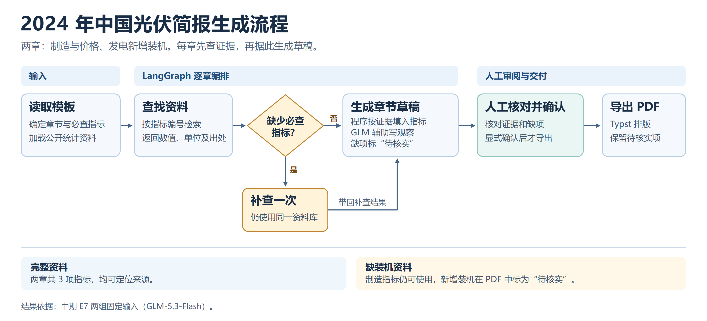

# 许子萌｜中期技术供稿

供田亦洁编写系统设计报告、李佳雨制作中期 PPT，以及程文博核对讲稿。图和文字围绕 2024 年中国光伏产业简报。技术说明按仓库已有代码和团队验证记录整理。

## 光伏简报生成流程

[SVG 矢量图](光伏简报生成流程.svg) · [PNG 插图](光伏简报生成流程.png)

**推荐图注。** 模板定义“制造与价格”和“发电新增装机”两章及必查指标。`run` 读取模板和已录入资料，LangGraph 按章执行初查；有缺项时只从同一批资料补查一次。程序用命中证据填写数值、单位、统计期和出处，GLM 返回证据编号和辅助观察，未找到的指标写成“待核实”。研究员核对草稿、统计口径和原文，再通过 `approve --confirm` 确认导出，Typst 生成 PDF。导出件保留来源和未核实项。 [模板](../../../code/templates/pv-brief.json) · [阶段编排](../../../code/report_app/pv_agent.py) · [模型适配](../../../code/report_app/pv_model.py) · [生成与审阅入口](../../../code/pv_brief.py)

**供报告对照的例子。** 团队真实 GLM 联调 E7 中，完整资料的 `missing` 为空；仅去掉国家能源局的装机资料后，装机的初查与补查均为空，`missing` 保留 `pv-new-capacity`，最终 PDF 中该项仍显示“待核实”。从 `events` 中依次查看该章的 `initial`、`supplement`、`draft` 即可回查。 [完整资料 trace](../evidence/glm-full.json) · [缺装机资料 trace](../evidence/glm-missing.json) · [E7 记录与样张](../evidence/README.md)

**本次复核（2026-11-27）。** 在当前工作区运行只读查询 `python -B code/pv_brief.py evidence pv-module-output pv-module-price pv-new-capacity`，完整资料返回 3 项；同一命令追加 `--omit-source NEA` 后只返回两项制造指标。流程和 PDF 的结果引用团队留存记录，本次复核只重新执行资料查询。

## 框架说明（两段可直接引用）

**DeepSeek Harness。** E4 使用 DeepSeek Harness `0.2.2-rc.5` 的 SDK 运行模式，通过标准输入输出连接只读 MCP 服务，将本项目的资料查询暴露为 `mcp__pv__search_evidence`。本机模拟模型先请求查询 `pv-new-capacity`；SDK 执行工具，再把带同一 `tool_use_id` 的 `tool_result` 放进第二次模型请求。收据中 `request_count=2`、`tool_result_reentered=true`，`tool_results[0].is_error=false`，内容中可核对国家能源局来源编号 `NEA` 和装机指标。 [E4 运行收据](../evidence/deepseek-harness.json) · [探针实现](../../../tools/midterm/dsh_probe.py)

**Pi CLI。** E5 使用 Pi `1.6.0`，通过扩展注册同一个只读 `search_evidence` 查询，扩展调用 Python 的 `pv_brief.py evidence` 命令。Pi 以 `--mode json` 输出事件，收据的 `events` 保留 `tool_execution_start`、`tool_execution_end` 和 `agent_end`，工具执行成功由探针检查。收据同时记录 `request_count=2`、`tool_result_reentered=true`，`tool_results` 可核对 `pv-new-capacity` 和 `NEA`，说明第二次请求确实带回了证据。E4 和 E5 都用本机模拟模型验证工具往返；项目光伏主流程由 LangGraph 编排，真实模型联调另见 E7。 [E5 运行收据](../evidence/pi-cli.json) · [探针实现](../../../tools/midterm/pi_probe.py) · [扩展实现](../../../tools/midterm/pi_evidence.mjs)

## 现场问答

- **补查会去网上找吗？** 补查由程序用本章尚缺的指标编号，在已载入的资料中查一次。以装机为例，去掉国家能源局资料后，补查为空，草稿和 PDF 都保留该项待核实。
- **模型和程序分别负责什么？** 模型提出首轮查询并返回 `selected`、`observation`。程序约束查询范围、核对证据编号，从证据字段填写数字和出处。模型输出不合规时可拒绝该章节或省略不合规的观察，具体取决于失败类型。
- **中断后怎么恢复？** 每个完成的章节保存检查点。同一输入追加 `--resume` 后复用已完成章节，未完成章节仍可能从头执行。E8 的 `resumed_sections=1`，记录了主动中断后跳过首章的那次运行。 [E8 运行记录](../evidence/glm-resume.json)

## 交接消息草稿

> 程文博、田亦洁、李佳雨，光伏简报的生成流程图和 DeepSeek Harness、Pi CLI 两段说明已整理在这份供稿里。已对照现有代码及 E4、E5 收据，核对了工具调用及证据回传，并用 E7 的完整和缺装机 trace 对照了补查和“待核实”的路径。图和两段正文可以放进系统设计报告和 PPT，运行记录链接在供稿中。
