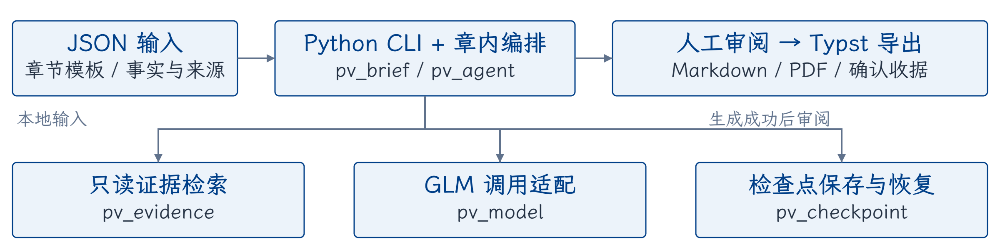

# 产业智能报告生成系统
## 系统设计报告

《软件工程管理》课程 · 第 11 组中期交付

**日期**：2026-11-22　**版本**：v0.7

**报告撰写**：田亦洁　**项目统筹**：程文博

**组员**：田亦洁、李佳雨、许子萌、崔大元、郭润航

### 中期交付

以2024年中国光伏产业简报为例，系统按章节找资料，写出带出处的草稿，保留缺项，经人工确认后导出 PDF。

## 目录

| 章节 | 内容 | 正文页码 |
| --- | --- | --- |
| 1 | 产品定位、用户任务与验收条件 | 1 |
| 2 | 智能体架构与章节生成流程 | 2 |
| 3 | 接口、数据与故障恢复 | 3 |
| 4 | 两份光伏简报的同栏对照 | 4 |
| 5 | 模型调用协议与章内状态 | 5 |
| 6 | 数据关系与文件一致性 | 6 |
| 7 | 故障恢复、审阅与运行权限 | 7 |
| 8 | 需求实现与验证结果 | 8 |
| 9 | 技术取舍与扩展边界 | 9 |
| 10 | 开发评审、组内交接与后续验证 | 10 |

实现依据仓库版本 7876b7c。M1–M4 是本报告沿用的中期需求编号，代码、输入资料和试验记录见文末索引。

<!-- pagebreak -->

# 1　产品定位、用户任务与验收条件

## 1.1　为写简报的人保留统计口径

研究员整理2024年光伏简报时，会遇到两种口径不同的数字。工信部的588 GW是组件产量，反映制造环节。国家能源局的2.78亿千瓦是发电新增装机，反映电站建设。写进报告时，要保留各自的年份、单位和原文出处。缺少装机资料时，报告应明确提示待核实。

产品定位是产业研究写作应用。使用者把主题和必查指标写入章节模板，将公开统计整理为来源与事实 JSON，再通过命令行生成简报。内容模板决定查哪些指标，版式模板决定核对后的文字怎样排成 PDF。

开题计划书 v1.8 涉及多个产业和报告类型。根据老师收窄范围的建议，中期集中完成光伏的“制造与价格”和“发电新增装机”两章，采用一套 PDF 版式。当前的 M1–M4 围绕按章取证、缺项检查、审阅导出和过程记录展开。

## 1.2　用四个动作验收

| 需求编号 | 用户要做什么 | 怎样判断做成了 |
| --- | --- | --- |
| M1 | 按章查数据 | 数字、时段、单位和出处能逐条回查。 |
| M2 | 识别缺少的资料 | 比对本章必查清单，只补查缺项一次。仍无结果就在对应指标处写“待核实”。 |
| M3 | 核对并导出 | 审阅 Markdown，确认后生成 PDF。缺项随 PDF 保留。 |
| M4 | 查明系统做过什么 | 从运行记录看到初查、补查、证据编号和缺项。 |

## 1.3　开题原型和中期的区别

E3 使用同一组统计摘编调用开题的摘录函数，按来源列出条目。中期流程在此基础上增加章节组织、补查和显式确认。两份产物可以比较工作流程的变化。

| 产品路标 | 共用能力 | 该阶段交付 |
| --- | --- | --- |
| 光伏简报 | 检索、补查、审阅与导出 | 两章三项指标，一份完整样张和一份缺资料样张。 |
| 风电复用验证 | 沿用光伏的章节流程和导出接口 | 换模板和资料，用一组固定输入检查复用范围（E12）。 |
| 参考报告检索 | 拟在写章前增加参考工具 | 先比较开放工具前后的事实错误和修订量，再决定是否接入。 |

<!-- pagebreak -->

# 2　智能体架构与章节生成流程

## 2.1　模块职责与数据流

{width=100%}

{width=100%}

Python 按模板顺序逐章运行，LangGraph 管理章内的初查、补查和成稿。GLM 提出查询，程序校验参数，再从输入资料中检索。例如装机章只允许查询 `pv-new-capacity`。补查由必查指标与检索结果的差集触发，最多执行一次。

成稿时，模型返回证据编号及可选观察，程序填入数字、单位和来源并保存章节。整篇完成后，研究员可修改辅助观察等自由文本。指标、来源、口径说明和缺项由审阅检查保护，确认后导出 PDF。

## 2.2　框架在项目中做什么

| 框架 | 项目中的应用 |
| --- | --- |
| LangGraph | 管理单章的初查、条件补查与写作节点。章节循环和保存由项目代码负责。 |
| DeepSeek Harness | SDK 通过只读 MCP 调用资料工具。E4 的本地模拟服务在第二次请求中收到装机证据。 |
| Pi CLI | 扩展注册同一个工具。E5 的 JSON 记录含工具执行的起止事件，第二次请求带回查询结果。 |
| DeepSeek chat-demo | 文件输入和草稿展示方式可供后续界面设计参考。 |

真实 GLM 联调走 LangGraph 主流程。离线演示由固定测试逻辑替代模型响应，重复展示同一条缺项分支。

<!-- pagebreak -->

# 3　接口、数据与故障恢复

## 3.1　一次任务经过哪些模块

Python 命令行读取章节模板和公开资料。LangGraph 1.2.24 负责步骤跳转，模型通过 Chat Completions 接口提出工具请求，资料工具返回对应条目。每写完一章就保存检查点。草稿和运行记录全部生成后，才发布到任务目录。Typst 使用独立版式生成 PDF。

| 接口 | 输入 | 输出与检查 |
| --- | --- | --- |
| `pv_brief.py run` | 新任务目录、模式，可选模板、资料集和排除来源 | 保存草稿、摘录和运行记录。生成中断可用同一输入加 `--resume` 恢复。 |
| `search_evidence` | 指标编号、来源表、事实表 | 返回匹配条目及原文位置。章内请求越界时，编排层拒绝执行。 |
| `ChatWriter` | 章节要求与工具结果 | 请求工具调用及章节 JSON。编排层核对证据编号，过滤不合规观察。 |
| `pv_brief.py inspect` | 任务目录，可选 `--json` | 列出每次检索、采用的证据和缺项。 |
| `pv_brief.py approve` | 任务目录、确认参数和可选修订稿 | 导出 Markdown、PDF 与校验哈希。数值、出处和缺项受保护。 |

## 3.2　核对时看哪些文件

| 实体 | 关键字段 | 保存位置 |
| --- | --- | --- |
| 来源与指标 | 数值、单位、统计期、来源 ID | pv-2024.json 中每个指标用 source 关联发布机构、链接和原文段落。 |
| 章节 | 标题、必查指标 ID、口径说明 | pv-brief.json 以指标 ID 关联事实。同一个模板可测试两种资料组合。 |
| 生成结果 | 草稿、同源摘录、逐章事件 | 任务目录的 draft.md、baseline.md、trace.json。在临时目录写齐后一起发布。 |
| 核对产物 | 定稿、PDF、确认记录 | reviewed 目录的 brief.md、brief.pdf、confirmation.json。收据保存定稿文本的 SHA-256。 |

运行模式分为 live 和 fixture。live 使用配置的模型服务，fixture 用固定返回结果复跑流程。新任务须指定尚不存在的目录。中断后的章节保存在同级检查点目录，恢复和审阅检查详见第 6、7 节。

<!-- pagebreak -->

# 4　两份光伏简报的同栏对照

## 4.1　只拿掉一份资料，观察装机一栏

用 GLM-5.3-Flash 跑两组输入。一组保留工信部和国家能源局的资料。另一组只移除国家能源局的资料，其余输入保持相同。

| 输入 | 装机章的检索 | 确认导出的结果（E7） |
| --- | --- | --- |
| 工信部、国家能源局 | 首次查询即返回 NEA 的装机证据。 | 组件产量 588 GW、组件价格同比下降 29.7%、新增装机 2.78 亿千瓦，三项均可回查。 |
| 仅保留工信部 | 初查和一次补查都没有返回装机证据。 | 保留两项制造数据，装机栏标明待核实。资料来源只列工信部。 |

{width=92%}

{width=92%}

两份 PDF 的“制造与价格”章都保留工信部的两项统计。缺装机用例中，制造章的一条附加观察被格式检查省略，trace 记为 omitted_invalid。装机章的初查和补查均返回空，selected 为空，missing 中只有 pv-new-capacity。运行记录分别记录了文字过滤和资料缺失。

两组样张及对应的 glm-full.json、glm-missing.json 位于中期 evidence 目录。图3、图4均取自 E7 原 PDF 的同一栏目。

<!-- pagebreak -->

# 5　模型调用协议与章内状态

## 5.1　将一次写作任务拆成两次模型请求

每章开始时，ChatWriter 发送章节标题、必查指标和口径说明，并声明 search_evidence 的参数结构。keys 只能取本章允许的指标编号。响应需要包含一次工具调用、有效的调用 ID 和正确的工具名称。适配器接受字符串或对象形式的参数，再由编排层检查请求列表是否为空、是否超出章节范围。

第二次请求负责组织章节。适配器保留原工具调用 ID，把已取得的可用证据按“首次请求的指标”和“其余补查指标”分组，分别放入 tool 消息和补充消息。模型据此返回 selected 与 observation。初查和补查的实际发生顺序保存在 trace 中。

| 对象 | 字段与约束 | 后续处理 |
| --- | --- | --- |
| 检索请求 | keys 是本章必查指标的非空列表 | Python 检查参数后调用只读工具，记录 requested 与 returned。 |
| 写作结果 | selected 覆盖本章全部可用证据编号 | 比较集合，漏选或选入未返回的编号都会终止该章。 |
| 附加观察 | observation 最多 100 字符 | 校验数字、方括号、换行、尖括号与网址等格式约束，违规时省略并记录。 |
| 章节事实 | 数值、单位、时段和来源 | 由程序读取证据条目并排入 Markdown，保留原始统计口径。 |

## 5.2　状态由证据覆盖情况推动

SectionState 保存 section、hits、selected、observation 和 events。initial 执行模型提出的初次查询。随后程序计算 required 中仍未出现在 hits 的指标，有缺项就转入 supplement，补查结束统一进入 draft。每章最多经过一次补查，分支没有回到 initial 的边。

补查条件固定，首次查询的指标由模型选择。E1 的离线模型首次只选一个指标，制造章因此补查组件价格。E7 的真实模型一次选齐制造章两项，直接进入写作。两次运行经过的节点不同，最终都按同一必查清单检查。

## 5.3　检索范围由输入资料决定

当前工具读取已整理的来源与事实 JSON。supplement 在同一资料集内按缺失编号再查，输入文件中的来源决定检索上限。扩大资料覆盖需要先补充来源条目、统计期、单位和定位信息。提示词负责引导调用，实际允许执行的工具和参数由代码检查。

<!-- pagebreak -->

# 6　数据关系与文件一致性

## 6.1　用指标编号连接模板和来源

一份内容模板含多个章节，每章用 required 指定指标编号及名称。事实条目的 id 对应这个编号，source 指向来源表的 id。来源条目集中存放发布机构、日期、链接和原文位置。同一发布页面可以支持多个指标，各指标也可以通过 locator 提供更精确的段落定位。

| 实体 | 主要字段 | 一致性规则 |
| --- | --- | --- |
| 内容模板 | title、scope、sections | 至少有一章。章节标题唯一，同一指标编号对应同一名称。 |
| 来源 | id、title、publisher、published_at、url、locator | ID 唯一，必需字段为非空单行文本，URL 通过 HTTPS 格式检查。 |
| 事实 | id、source、metric、period、value、unit | source 必须已登记，metric 与模板中的同编号名称一致。 |
| 章节结果 | hits、selected、events | 记录检索命中及采用编号，恢复时重新对照当前输入校验。 |
| 检查点 | fingerprint、completed、in_progress、interruptions | 保存已完成章和中断状态，输入指纹一致才允许恢复。 |

以装机指标为例，模板要求 pv-new-capacity，事实表中对应 2024 年、2.78 亿千瓦、来源 NEA，来源表再给出国家能源局原文链接及“光伏发电建设和运行情况”段落。这样从章节到数值、从数值到原文都有可追查的关联。

## 6.2　一次任务何时成为完整产物

生成期间，完整章节写入同级隐藏目录中的 completed.json。文件先写到临时路径，刷新并同步到磁盘后再替换正式检查点。任务结束时，草稿、摘录基线与 trace.json 在临时目录全部写齐，再通过目录重命名发布到目标路径。生成失败时，已保存的章节留在检查点中供恢复。

检查点目录中的 lock.sqlite3 通过 SQLite 写事务限制同一任务的并发生成。章节内容存放在 JSON，进程退出会释放锁。最终任务目录按本次运行单独保存，新任务要求使用新路径，便于对照两组输入和各自的证据。

## 6.3　确认记录的核对范围

reviewed 目录包含核对后的 Markdown、PDF 和 confirmation.json。收据保存运行模式、缺项、冲突项及 Markdown 的 SHA-256，可据此核对交付文本。事实与推断的审核则通过原文和章节内容完成。

<!-- pagebreak -->

# 7　故障恢复、审阅与运行权限

## 7.1　恢复时保留哪些工作

每完成一章就保存结果。恢复命令沿用任务路径并追加 --resume，程序先比较模板、资料、运行模式、模型地址及模型名称形成的指纹，再校验已保存章的查询事件与采用证据。输入发生变化时改用新任务路径。未完成章节从头执行，trace 中用 resume_retry 记录重跑次数。

| 触发情况 | 程序反应 | 恢复或核对方式 |
| --- | --- | --- |
| 模型超时或不可用 | 返回失败及已保存章节数 | 检查服务后用相同输入恢复。请求等待默认 60 秒，可由参数调整。 |
| 工具调用或草稿格式错误 | 返回 invalid_tool_call 或 invalid_section | 检查响应及设置。同一模型路由可恢复，改换模型则新建任务。 |
| 编号与证据不一致 | 返回 invalid_selection | 核查返回编号及工具命中，完整章节通过检查后才保存。 |
| 修改受保护的事实行 | 审阅校验失败 | 误改稿件时恢复原行。事实确需修正时，更新资料并重新生成。 |
| Typst 缺失或编译失败 | 导出命令失败 | 修复本地依赖后重新导出，草稿仍可供人工检查。 |

## 7.2　确认动作与文字修订

approve 要求显式传入 --confirm，可用 --markdown 指定修订稿。程序比较标题、运行状态、指标、来源和缺项等受保护内容及其顺序，防止修订时把数字移到另一章或遗漏来源。审阅稿上限为 20000 字符，还须保留唯一的待确认状态标识。通过后再转换为已确认状态并调用 Typst。

导出在临时目录完成，编译等待上限为 30 秒。成功后同时发布 Markdown、PDF 和确认收据。已经存在 reviewed 目录的任务会拒绝再次覆盖，后续修改需要保留原件并使用明确的新任务版本。

## 7.3　运行环境与数据权限

当前简报通过本地 Python CLI 运行，仓库验证环境为 Python 3.12、LangGraph 1.2.24，PDF 输出使用 Typst 和仓库字体。模型名称、接口地址与凭据从本机配置或环境变量读取，环境变量优先。远程接口要求 HTTPS。live 模式会把章节和证据发送到配置的模型服务，当前样例使用公开统计摘编。

资料工具只读，任务目录按本机文件权限管理。--confirm 记录本地操作人的显式确认。断网时可用 fixture 复跑固定案例，也可继续审阅已有 Markdown。多人在线审阅所需的账号和任务授权留在后续界面设计阶段处理。

<!-- pagebreak -->

# 8　需求实现与验证结果

## 8.1　按同一任务核对实现

| 验证方式 | 材料编号 | 实际检查 |
| --- | --- | --- |
| 离线复跑与摘录对照 | E1–E3 | 用两种资料组合检查补查条件、章节结构和 PDF 确认导出。 |
| 本地模拟模型 | E4、E5 | DeepSeek Harness 和 Pi 各自调用了工具，结果进入下一次模型请求。 |
| 自动测试 | E6 | 仓库记录 18 项基线与 9 项中期测试通过，含审阅保护、伪造引用和恢复。 |
| 真实模型与主动中断 | E8 | 第一章完成后退出进程。重启跳过该章，写完装机章并导出 PDF。 |

## 8.2　需求、代码与观察

| 编号 | 实现 | 对应证据 |
| --- | --- | --- |
| M1 | pv_evidence 检索，pv_agent 按证据填数 | E7 完整输入三项均可回查。E1 首查只取一项，补查找回组件价格。 |
| M2 | section_graph 比对必查清单 | E7 移除 NEA 后，装机查找两次均空，缺项一直保留到 PDF。 |
| M3 | approve_run 核对并调用 Typst | E6 验证审阅保护。E7 样张分别显示“已按命令确认”和确认后仍有待核实项。 |
| M4 | trace.json、inspect 与章节检查点 | E8 主动中断后 resumed_sections 为 1，装机章记录一次重跑，最终缺项为零。 |

## 8.3　验证记录的时间与适用范围

E6 记录中期的 18 项基线测试和 9 项简报测试，封版后简报测试增加到 12 项。E4、E5 检查模拟服务下的工具回传，E7、E8 检查真实 GLM 的成稿与恢复。后续跨任务评测将统一记录事实错误、耗时和人工修改量。

<!-- pagebreak -->

# 9　技术取舍与扩展边界

## 9.1　让证据约束写作

直接让模型自由生成整篇报告，数值、来源和文字推断会混在一次输出中。本项目把数值交给确定性的证据格式化函数，把简短观察交给模型，代价是草稿形式较固定，能支持的指标取决于输入资料。这个取舍适合当前两章简报，审阅者可以逐项检查三条事实。

观察格式检查主要过滤可能引入新数字或链接的输出，语义是否成立仍由人核对。同一指标的冲突检查比较统计期、数值和单位的原字段，字段不同就并列保留候选记录。即使两个数值经过单位换算可能相等，当前实现也交由人判断。因此来源整理时就应保留原始口径，后续若增加标准化换算，还需保留转换依据。

## 9.2　选择有限流程，保留调用记录

当前章内只有初查、条件补查与成稿三个节点，流程结束条件明确。LangGraph 负责分支，ChatWriter 负责模型协议，pv_checkpoint 负责持久化。各模块可以围绕同一指标独立检查，E4、E5 的工具探针也复用了资料检索实现。

每章常规路径含两次模型请求，补查由程序直接调用本地资料工具。两章正常完成通常需要四次模型请求，失败后重跑未完成章可能增加调用。这个数量来自当前调用结构，实际费用还取决于服务计费、上下文长度和重跑情况。运行记录尚未形成覆盖多任务的 token 与费用统计。

按章保存增加了本地写入和校验，但 E8 已显示恢复时可以跳过第一章。E10 的本地延迟试验也保留了第一章冲突记录，恢复轮只请求第二章。E11 把真实 GLM 的等待时间人为设为 0.1 秒后触发失败，恢复默认等待后完成，记录的两次耗时为 0.488 秒与 23.429 秒。它们是单次试验值，后续性能评估应按相同资料和参数重复测量。

## 9.3　后续扩展与验证

E12 用风电两章三项指标复用了检索、写作和导出，支持“替换模板与资料可以复用流程”的判断。增加 PDF 自动解析、联网检索或更多报告类型后，还需要检查抽取错误、来源定位和章节指标匹配。目前事实由结构化资料提供，范围受输入覆盖约束。

参考报告工具拟返回带报告名、版本、页码和片段 ID 的结构参考。试验前确定必需章节和修订标准，对同一资料分别关闭、开放工具，比较事实错误、结构修改、人工用时与额外调用量，据此决定是否接入。

<!-- pagebreak -->

# 10　开发评审、组内交接与后续验证

## 10.1　产品路标与评审点

结合课上提出的 IPD 阶段评审思路，本次准备拟按三个问题组织评审。概念评审看光伏简报服务什么任务，计划评审确认两章三项指标和资料组合，开发验证评审核对两份 PDF 与运行记录。组内计划于 11 月 23 日讨论范围、11 月 29 日彩排。

光伏流程封版后，E9 加入合成冲突数据，输出保留两个候选值供核对。E10 在本地模拟服务里延迟第二章响应，E11 则对真实 GLM 人为缩短客户端等待时间。E12 更换为固定风电资料与模板，复用了同一流程。它们回答的是冲突、超时和模板复用三个问题，图3、图4的中期对照仍以 E7 为准。

## 10.2　围绕同一指标交接

| 成员 | 环节 | 可检查的交接件与暂排时间 |
| --- | --- | --- |
| 田亦洁、程文博 | 定义任务与验收 | 田亦洁写明各章必查什么、缺项怎样判定，11/28 校稿。程文博统筹范围、验收和主讲。 |
| 崔大元、许子萌 | 准备证据、接入工具 | 11/25 对照原文整理指标及单位，11/27 核对 Agent 工具回传和补查流程。 |
| 李佳雨、郭润航 | 样张复核与演示 | 李佳雨拟于 11/27 完善 PPT。郭润航准备 11/28 独立验证和 11/29 计时彩排。 |

交接以来源表、流程说明和两份样张为单位。出现数值争议时，资料负责人定位原文，编排负责人核对查询记录，复跑成员用同一输入检查修改。范围和取舍由程文博协调，具体交接时间与复核结果随文件记录。

## 10.3　AI 使用与内容复核

本稿于 2026 年 11 月 22 日使用 Codex 辅助整理接口说明、对照记录和排版。数值对照发布机构原文及 E7 样张，流程说明对照代码和 JSON 事件。田亦洁负责章节、接口与检查条件的人工复核，程文博负责汇报口径与最终验收。

AI 生成的流程说明逐项对照函数职责。例如，LangGraph 的条件边控制章内补查，章节循环和检查点由项目代码完成，两部分在图中分别标出。测试通过数量引用仓库已有记录，后续复跑结果随组内验收更新。

<!-- pagebreak -->

# 参考资料与版本记录

- [软件工程管理课程报告与评分细则（2026年）](https://github.com/BrockPhlin/industry-report-harness/blob/7876b7c/materials/references/课程报告与评分细则.md#section-05)，系统设计报告内容要求及通用形式要求。
- 课堂练习“实践任务：小组产品规划”，本次提供的截图，涵盖产品定位、路标、IPD 与团队组织。
- [DeepSeek Harness SDK](https://github.com/deepseek-ai/deepseek-harness/tree/master/packages/sdk) 与 [MCP 客户端](https://github.com/deepseek-ai/deepseek-harness/tree/master/packages/mcp/mcp-client)。
- [Pi coding agent CLI](https://github.com/earendil-works/pi/tree/main/packages/coding-agent) 与 [扩展文档](https://github.com/earendil-works/pi/blob/main/packages/coding-agent/docs/extensions.md)。
- [DeepSeek chat-demo](https://github.com/deepseek-ai/chat-demo)。
- [智谱 GLM-5.3-Flash 模型文档](https://docs.bigmodel.cn/cn/guide/models/vlm/glm-5.3-flash)。
- [LangGraph Graph API](https://docs.langchain.com/oss/python/langgraph/graph-api)。
- [工信部　2024年全国光伏制造行业运行情况](https://wap.miit.gov.cn/gyhxxhb/jgsj/dzxxsnew/xyyx/art/2025/art_1717bf6fa0a34311a2c347fb9623e607.html)。
- [国家能源局　2024年可再生能源并网运行情况](https://www.nea.gov.cn/20250221/e10f363cabe3458aaf78ba4558970054/c.html)。

运行证据按试验编号索引。[E1–E8 中期记录与样张](https://github.com/BrockPhlin/industry-report-harness/blob/7876b7c/presentations/02-midterm/evidence/README.md)包含完整与缺装机两组 GLM 样张和各自的 JSON。[E9–E12 封版后补充验证](https://github.com/BrockPhlin/industry-report-harness/blob/7876b7c/presentations/03-final/evidence/README.md)记录冲突、超时与风电用例。

| 核对内容 | 仓库中的文件 | 可回查的信息 |
| --- | --- | --- |
| 章内调用与校验 | code/report_app/pv_agent.py、pv_model.py | 初查、补查、成稿的跳转，工具参数与证据编号检查。 |
| 数据与恢复 | code/report_app/pv_evidence.py、pv_checkpoint.py | 输入字段关联、来源定位、指纹、文件写入和并发锁。 |
| 确认与导出 | code/pv_brief.py | review_contract、approve_run、Typst 调用和收据。 |

v0.7 核对课程细则与实现，补清模块关系、补查分支和需求版本，修正输入、检索和审阅表述。v0.6 扩充接口、数据与技术取舍。v0.5 加入同栏样张。v0.4 增加总体结构与恢复测试。

编辑器 Vim 9.2，正文字数 5793。
